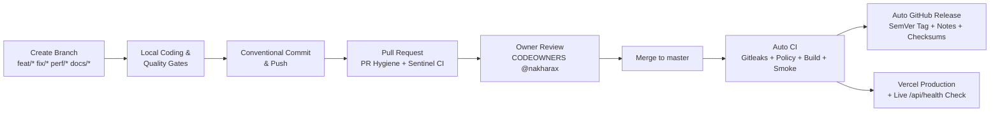

# TallyNX Desk & Mall

> **Institutional Risk Management Terminal, Behavioral Review Workspace & Community Mall for Prop-Firm Traders**  
> *Non-Custodial · Pure SaaS Analytics · Open-Source Governance*

[](https://github.com/nakharax/tallynx-desk/actions/workflows/deploy-vercel.yml)
[](https://github.com/nakharax/tallynx-desk/actions/workflows/pr-hygiene.yml)
[](https://github.com/nakharax/tallynx-desk/actions/workflows/release.yml)
[](LICENSE)

> **หมายเหตุภาษาไทย (Thai Quick Navigation):**  
> TallyNX Desk & Mall เป็นซอฟต์แวร์วิเคราะห์ความเสี่ยงและทบทวนพฤติกรรมการเทรดแบบ **Non-Custodial** (ไม่รับฝากเงิน ไม่ส่งคำสั่งซื้อขายอัตโนมัติ และไม่ให้คำแนะนำการลงทุน) หากต้องการร่วมพัฒนา ดูขั้นตอนการสร้าง Branch, Commit และเปิด PR ได้ที่ [CONTRIBUTING.md](CONTRIBUTING.md) หรือแจ้งช่องโหว่ความปลอดภัยที่ [SECURITY.md](SECURITY.md)

---

## Core Capabilities

| Module | Description |
| :--- | :--- |
| **3-TP Ladder & Position Sizing** | Decimal-accurate (`decimal.js`) risk-per-trade calculator with 3-tier take-profit scaling, R-multiple projections, and daily/max drawdown guardrails. |
| **30-Second Statement Autopsy** | Fast forensic parser for MT4/MT5 statements, CSV, and XLSX exports—surfacing revenge-trading clusters, session drift, tilt sequences, and rule proximity. |
| **News Blackout Radar** | High-impact macroeconomic event timeline highlighting prop-firm news-window restrictions before execution. |
| **Community Mall & Marketplace** | Curated workspace for community-contributed risk templates, behavioral checklists, and analytical modules. |
| **Non-Custodial MT5 Bridge** | Read-only local telemetry bridge (`scripts/TredynLiveBridge.mq5` / `.ex5`) that streams account equity/drawdown snapshots without broker credentials or order execution privileges. Verified in CI for source-to-binary parity. |

---

## Architecture Overview

```text
┌─────────────────────────────────────────────────────────────────────────┐
│                        TallyNX Desk & Mall                              │
├──────────────────────────────┬──────────────────────────────────────────┤
│  Frontend (SPA / PWA)        │  Backend & Edge Runtime                  │
│  • React 19 + TypeScript     │  • Express / tsx local dev server        │
│  • Vite 8 + Tailwind CSS 4   │  • Vercel serverless API bundle          │
│  • Recharts + Three.js       │  • Firestore per-UID security rules      │
│  • Decimal.js risk math      │  • Optional Gemini AI behavioral review  │
├──────────────────────────────┴──────────────────────────────────────────┤
│  Local Telemetry (Optional, Non-Custodial)                              │
│  • MT5 Terminal ──► TredynLiveBridge.ex5 (read-only) ──► Local Desk API │
└─────────────────────────────────────────────────────────────────────────┘
```

---

## Quickstart

### Prerequisites
- **Node.js** `22.x` (LTS) and **npm** `10+`
- **Python 3.12+** (optional, only required for Playwright responsive smoke tests)

### 1. Clone & Install

```bash
git clone https://github.com/nakharax/tallynx-desk.git
cd tallynx-desk
npm ci
```

### 2. Configure Environment

Copy the example environment file and populate only the variables you need for local development:

```bash
cp .env.example .env.local
```

> Never commit `.env.local` or real API keys. All pull requests are scanned automatically by Gitleaks.

### 3. Run Locally

```bash
npm run dev
```

### 4. Run Local Verification Gates

Before opening a pull request, run the exact same gates enforced by Sentinel CI:

```bash
# 1. Static TypeScript verification
npm run lint

# 2. Deterministic unit tests
npx tsx --test src/utils/*.test.ts

# 3. Legal Safe Harbor, Brand Hygiene & MT5 Bridge binary parity guard
node scripts/ci-policy-guard.mjs

# 4. Production Vite + API bundle build
npm run build
```

Optional mobile/tablet Playwright responsive smoke check:

```bash
npm run test:responsive
```

---

## Open-Source Contribution & Release Lifecycle

All changes follow a strict, deterministic delivery pipeline from feature branch to production:

```text
Create Branch ──► Code & Test ──► Conventional Commit ──► Push & Open PR
                                                               │
                                                               ▼
Production Update ◄── Auto GitHub Release ◄── Auto CI ◄── Owner Review & Merge
```



### CI Security & Fork PR Safety
- **External Fork PRs** run `pr-hygiene`, `secret-scan` (Gitleaks SHA-256 verified), `policy-audit`, `verify-and-build`, `responsive-smoke`, and `sentinel-ci` with strictly `contents: read` permissions and **zero access to deployment secrets**.
- **Preview Deployments** run only on trusted non-fork PRs after `sentinel-ci` passes.
- **Production Deployments & Releases** trigger exclusively on `master` after all fail-closed CI gates succeed.

---

## Project Governance & Docs

- [CONTRIBUTING.md](CONTRIBUTING.md) — Branching, Conventional Commits, local gates, and PR workflow
- [SECURITY.md](SECURITY.md) — Non-custodial threat model and responsible vulnerability disclosure
- [CODE_OF_CONDUCT.md](CODE_OF_CONDUCT.md) — Contributor Covenant v2.1
- [CHANGELOG.md](CHANGELOG.md) — Version history and release milestones
- [LICENSE](LICENSE) — MIT License

---

## Legal Safe Harbor Notice

TallyNX Desk & Mall is strictly an **analytical, educational, and behavioral risk management software tool** (Pure SaaS).

- **Non-Custodial:** TallyNX does not custody funds, access broker passwords, or execute live orders on behalf of users.
- **Not Financial Advice:** Nothing in this repository, UI, documentation, or AI review output constitutes financial advice, investment recommendations, or buy/sell trade signals.
- **User Responsibility:** Traders retain 100% control over and responsibility for all trading decisions, position sizing, and compliance with third-party prop-firm rules. No analytical tool can assure trading outcomes or evaluation results.
